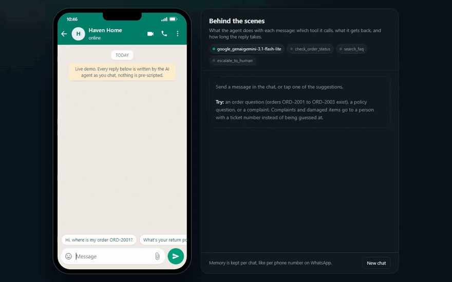

<h1>WhatsApp Support Agent</h1>

<b>Answers customer questions on WhatsApp. It checks real order data, answers from the store's FAQ, and hands over to a person when it shouldn't be guessing.</b>

  
  
  
  
  
  

  <a href="#what-it-does">What it does</a> &nbsp;|&nbsp;
  <a href="#how-it-works">How it works</a> &nbsp;|&nbsp;
  <a href="#sample-run">Sample run</a> &nbsp;|&nbsp;
  <a href="#quick-start">Quick start</a> &nbsp;|&nbsp;
  <a href="#configuration">Configuration</a> &nbsp;|&nbsp;
  <a href="#roadmap">Roadmap</a>

 

<h2>See it in action</h2>

Recorded in the built-in chat screen from a real run on Google Gemini (<code>gemini-3.1-flash-lite</code>) on 14 November 2026. Nothing is scripted. Only the time spent waiting for the model is fast-forwarded, and the real response times are shown on screen. The panel on the right shows every tool the agent called, what it got back and how long the reply took. <a href="demo/demo.mp4">Download the MP4</a>.

<h2>The problem</h2>

In many markets customers don't email, they message on WhatsApp. Small teams can't reply around the clock, and slow replies on a chat app feel slower than on any other channel.

Most of those messages are "where is my order" and policy questions, which an agent can answer well, as long as it knows when to step aside.

<h2>What it does</h2>

<table>
  <tr><th align="left">Capability</th><th align="left">What that means in practice</th></tr>
  <tr><td><b>Order status</b></td><td>Looks up the order and replies in a sentence or two.</td></tr>
  <tr><td><b>FAQ answers</b></td><td>Store hours, returns, shipping and payment, from the store's own FAQ.</td></tr>
  <tr><td><b>Escalation</b></td><td>Complaints, damaged items and anything uncertain go to a person with a ticket number.</td></tr>
  <tr><td><b>Chat-style replies</b></td><td>Short and friendly, the way people actually write on WhatsApp.</td></tr>
  <tr><td><b>Memory per customer</b></td><td>The phone number is the conversation ID, so each customer's history is kept separately.</td></tr>
  <tr><td><b>Production webhook</b></td><td>Verifies Meta's signature, replies in the background so Meta never times out, and never answers the same message twice.</td></tr>
</table>

<h2>How it works</h2>

<pre>
WhatsApp --&gt; Meta Cloud API --&gt; POST /webhook (FastAPI)
                                    | check signature, skip duplicates, return 200
                                    v
                         agent (tool calling, memory per phone number)
                           |-- check_order_status
                           |-- search_faq
                           |-- escalate_to_human
                                    |
                                    v
                    reply sent through the Graph API --&gt; customer
</pre>

The agent is built with LangChain's <code>create_agent</code> and three tools. It decides which tool to call from the conversation. <code>app.py</code> is a FastAPI server that handles Meta's verification handshake and incoming messages.

The same server also has a chat screen at <code>/</code>, so you can try the agent in the browser before setting up a Meta developer account. It runs exactly the same agent, and a side panel shows each tool call and its result. <code>simulate_chat.py</code> does the same in the terminal.

<h2>Decisions I made on purpose</h2>

<h3>Escalation is the most important tool</h3>

Without it, the agent tries to resolve a complaint it has no authority over, which is worse than saying "let me get someone". Damaged items and upset customers go straight to a person.

<h3>Built for how webhooks fail in real life</h3>

Meta resends a message if the webhook is slow to respond, and it sends delivery receipts to the same endpoint. The server answers Meta first, generates the reply in the background, ignores non-text events and skips message IDs it has already handled.

<h2>Sample run</h2>

From the recording above, word for word:

<pre>
Customer: Hi, where is my order ORD-2001?
  tool:   check_order_status(order_id="ORD-2001")
Agent:    Your order for the Ceramic Coffee Mug Set is out for delivery today,
          November 14.

Customer: What's your return policy?
  tool:   search_faq(query="return policy")
Agent:    You can return any item within 14 days of delivery, as long as it is
          unused and in its original packaging. Just send me your order ID if
          you would like to start a return.

Customer: My order ORD-2002 arrived broken and honestly I'm pretty annoyed
  tool:   escalate_to_human(reason="Customer reported order ORD-2002 arrived broken and is expressing frustration.")
Agent:    I am very sorry to hear that your order arrived broken. I have escalated
          this to a member of our support team and someone will follow up with
          you shortly to resolve this.
          (ticket WA-26130)
</pre>

<h2>Quick start</h2>

You need Python 3.12 or newer and an API key from OpenAI, Anthropic or Google Gemini.

<pre>
pip install -r requirements.txt
cp .env.example .env        # on Windows: copy .env.example .env
# open .env and paste your API key
python app.py                  # opens the chat screen at http://localhost:8000
</pre>

No WhatsApp account is needed for the chat screen. Prefer the terminal? Run <code>python simulate_chat.py</code>.

To connect a real number: create a Meta developer app with the WhatsApp product, put the access token, phone number ID, verify token and app secret in <code>.env</code>, run <code>python app.py</code> (or <code>uvicorn app:app --port 8000</code> on a server), expose it with ngrok, and set the ngrok URL plus <code>/webhook</code> as the callback in the Meta app.

<h2>Configuration</h2>

Everything is set in <code>.env</code>. Copy <code>.env.example</code> to start.

<table>
  <tr><th align="left">Variable</th><th align="left">Required</th><th align="left">Purpose</th></tr>
  <tr><td><code>LLM_MODEL</code></td><td>Yes</td><td>Which model to use, as <code>provider:model</code>. Default <code>openai:gpt-5.5</code>. Also works with <code>anthropic:claude-opus-5-5</code> or <code>google_genai:gemini-3.5-flash</code>.</td></tr>
  <tr><td><code>OPENAI_API_KEY / ANTHROPIC_API_KEY / GOOGLE_API_KEY</code></td><td>One of them</td><td>The key for whichever provider you picked.</td></tr>
  <tr><td><code>WHATSAPP_ACCESS_TOKEN, WHATSAPP_PHONE_NUMBER_ID</code></td><td>For live WhatsApp</td><td>From the WhatsApp section of your Meta app.</td></tr>
  <tr><td><code>WHATSAPP_VERIFY_TOKEN</code></td><td>For live WhatsApp</td><td>Any string you choose. Enter the same one in the Meta webhook settings.</td></tr>
  <tr><td><code>WHATSAPP_APP_SECRET</code></td><td>Recommended</td><td>Lets the webhook reject requests that Meta didn't sign.</td></tr>
  <tr><td><code>WHATSAPP_GRAPH_API_VERSION</code></td><td>No</td><td>Graph API version, default <code>v23.0</code>.</td></tr>
</table>

<h2>Project structure</h2>

<pre>
whatsapp-support-agent/
  .env.example          # copy to .env and add your key
  app.py                # FastAPI: chat screen, chat API and the Meta webhook
  case_study.md         # longer write-up of the design
  README.md
  requirements.txt      # dependencies
  simulate_chat.py      # same agent in the terminal
  whatsapp_client.py    # payload parsing, signature check, sending
  agent/
    core.py             # the tool-calling agent and its memory
    llm.py              # picks the model from LLM_MODEL
    tools.py            # order lookup, FAQ search, escalation
  data/
    faq.json            # store FAQ
    orders.json         # demo orders
  demo/                 # recording of a live run (GIF, MP4 and a screenshot)
  tests/                # pytest suite, runs without any API key
  web/
    index.html          # the chat screen, one file, no build step
</pre>

<h2>Built with</h2>

Python &nbsp;&middot;&nbsp; LangChain &nbsp;&middot;&nbsp; LangGraph &nbsp;&middot;&nbsp; FastAPI &nbsp;&middot;&nbsp; WhatsApp Cloud API &nbsp;&middot;&nbsp; OpenAI / Anthropic / Gemini

<h2>Tests</h2>

<pre>
pip install -r requirements-dev.txt
pytest
</pre>

Five tests cover the tools, parsing Meta's webhook payloads, the verify-token handshake, signature checking, duplicate messages, and the chat screen and its API. None of the tests call a model or need an API key, so they run on GitHub Actions on every push. The badge at the top shows the latest result.

<h2>Roadmap</h2>

What I would build next if a client took this into production:

<ul>
  <li>Connect <code>check_order_status</code> to a real Shopify or WooCommerce store. It is the only file that changes.</li>
  <li>Approved message templates, so the business can message customers first</li>
  <li>A live takeover path, so a person can step into the conversation</li>
  <li>Retries on the Graph API call, and a database for memory that survives restarts</li>
</ul>

<h2>More from this series</h2>

Nine production-minded AI agents, each solving one business problem properly.

<table>
  <tr><td><a href="https://github.com/saqib-n/ai-research-report-agent"><b>Research Report Agent</b></a></td><td>Researches a topic, notices its own gaps, and writes a report with a source for every claim.</td></tr>
  <tr><td><a href="https://github.com/saqib-n/ai-sales-outreach-agent"><b>AI Sales Outreach Agent</b></a></td><td>Personalised cold emails and follow-ups, with a human approving every send.</td></tr>
  <tr><td><a href="https://github.com/saqib-n/ecommerce-automation-agent"><b>E-commerce Order and Inventory Agent</b></a></td><td>Shopify order, stock and returns assistant, plus a monitor that warns you before stock runs out.</td></tr>
  <tr><td><a href="https://github.com/saqib-n/email-triage-agent"><b>Email Triage Agent</b></a></td><td>Sorts an inbox into four buckets and gives each one a different level of autonomy.</td></tr>
  <tr><td><a href="https://github.com/saqib-n/lead-qualification-crm-agent"><b>Lead Qualification Agent</b></a></td><td>Scores inbound leads against your own rubric and pushes the good ones to HubSpot.</td></tr>
  <tr><td><a href="https://github.com/saqib-n/multi-agent-customer-support"><b>Multi-Agent Customer Support</b></a></td><td>A router plus specialist agents for orders, refunds, FAQs and human handoff.</td></tr>
  <tr><td><a href="https://github.com/saqib-n/rag-knowledge-base-agent"><b>RAG Knowledge Base Agent</b></a></td><td>Answers questions from your own documents and names the source for every answer.</td></tr>
  <tr><td><a href="https://github.com/saqib-n/recruiting-screening-agent"><b>Resume Screening Agent</b></a></td><td>Ranks resumes against a job description with evidence, and guards against common bias.</td></tr>
</table>

<h2>Work with me</h2>

I'm Saqib Nawaz, founder of WolfXense AI. I build AI agents and automations for businesses, with Python, LangChain, LangGraph and n8n, and connect them to the tools teams already use, like CRMs, Shopify, Slack, email and WhatsApp.

If your customers already message you on WhatsApp, I can put this agent on your business number and connect it to your store and your support team.

<a href="https://www.upwork.com/freelancers/~01de008504a38baf28"><b>Hire me on Upwork</b></a> &nbsp;|&nbsp; <a href="https://github.com/saqib-n"><b>More of my work on GitHub</b></a>

Released under the <a href="LICENSE">MIT License</a>. A longer write-up of the design is in <a href="case_study.md">case_study.md</a>.

